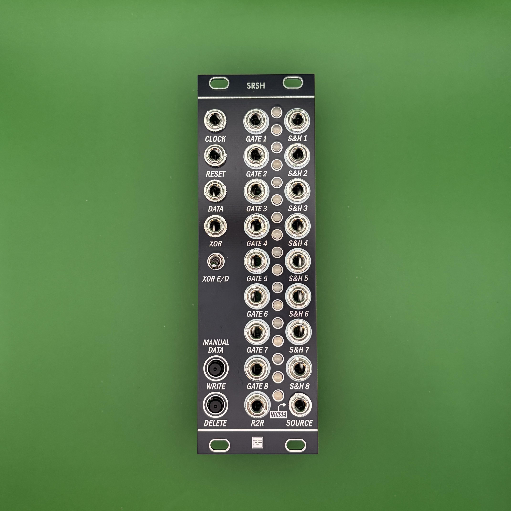

# SRSH

## 概要 / Overview

**SRSH** は、8Stepのシフトレジスタと、8段のサンプル＆ホールド（S&H）を組み合わせたモジュールです。  
- GATE 出力 ×8 を備えた 8Stepシフトレジスタ（DATA / XOR 入力、WRITE / DELETE ボタン付き）  
- シフトレジスタのビットの動きに連動して電圧を受け渡す8段の S&H  
- 8 つのビットを 1 本の CV にまとめる R2R 出力  
の3つを1台にまとめ、リズムとランダムな電圧を同時に作り出せます。  
S&H の入力（SOURCE）に何も挿さなければ、内蔵のホワイトノイズをサンプルします。

---

**SRSH** is a module that combines an 8-step shift register with an 8-stage sample & hold (S&H).  
- An 8-step shift register with 8 GATE outputs (with DATA / XOR inputs and WRITE / DELETE buttons)  
- An 8-stage S&H that passes voltages along in step with the movement of the shift register bits  
- An R2R output that combines the 8 bits into a single CV  

All three are combined in one module, so you can create rhythms and random voltages at the same time.  
When nothing is patched into the S&H input (SOURCE), the module samples its built-in white noise.

## 仕様 / Spec
- Format: Eurorack
- Function: 
- Current needs: +12V: 90mA, -12V: 40mA
- Width: 8 HP
- Depth: 27mm (including power connector)

## 販売 / Sales

StudioKATオフィシャルショップで販売しています。(日本国内限定)  
https://www.studiokat.jp/164466540

## ライセンス / License

この作品は [Creative Commons 表示 - 継承 4.0 国際 (CC BY-SA 4.0)](https://creativecommons.org/licenses/by-sa/4.0/deed.ja) の下でライセンスされています。  
This work is licensed under the [Creative Commons Attribution-ShareAlike 4.0 International License](https://creativecommons.org/licenses/by-sa/4.0/).

## クレジット / Credits

- Designed by : StudioKAT
- Website : https://www.studiokat.jp/
- GitHub : https://github.com/StudioKAT
- X(Twitter) : https://x.com/StudioKAT_synth
- Instagram : https://www.instagram.com/studiokat_modular/

## 更新履歴 / Changelog

- `2026-10-30` v1.0 Released version 1.0