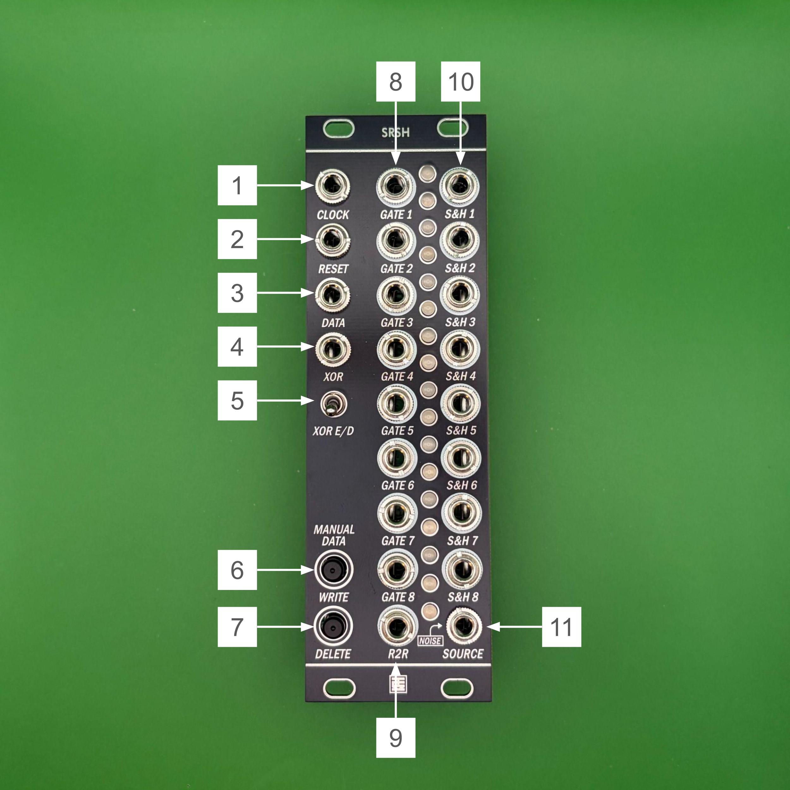

# SRSH v1.0 Manual (English)


## Overview

**SRSH** is a module that combines an 8-step shift register with an 8-stage sample & hold (S&H).  
- An 8-step shift register with 8 GATE outputs (with DATA / XOR inputs and WRITE / DELETE buttons)  
- An 8-stage S&H that passes voltages along in step with the movement of the shift register bits  
- An R2R output that combines the 8 bits into a single CV  

All three are combined in one module, so you can create rhythms and random voltages at the same time.  
When nothing is patched into the S&H input (SOURCE), the module samples its built-in white noise.


---

## Specifications

- **Format**: Eurorack
- **Width**: 8 HP
- **Depth**: 27 mm
- **Current draw**: +12V: 90mA / -12V: 40mA

> ※ Make sure the red stripe on the power cable is connected to -12V.
> Connecting the cable the wrong way can damage the module.
> **Always check the orientation of the cable before turning the power on.**

---

## Panel Functions



1. **Clock IN**  
    Clock input. On every rising edge, the shift register bits advance by one stage (in the direction Gate 1 → Gate 8).
    The new bit is determined by the state of DATA IN, XOR IN, and the Write / Delete buttons at that moment, and enters stage 1. The bit in stage 8 is pushed out and discarded.
    The module follows clocks up to about 1kHz.
    During a firmware update, this jack is also the input for the update audio (see "Firmware Update").

2. **Reset IN**  
    Reset input. On a rising edge, all bits are cleared to 0 (all Gates turn off), and at the same time S&H OUT 1–8 are all set to the current SOURCE voltage.

3. **DATA IN**  
    Data input for the shift register. If this input is HIGH at the moment of the clock's rising edge, a 1 enters stage 1; if it is LOW, a 0 enters.
    It is intended for gates, triggers, LFOs, and similar signals.

4. **XOR IN**  
    Input for XOR. When the XOR switch is enabled, the value that enters stage 1 is the exclusive OR (XOR) of DATA IN (and the Write button) with XOR IN.
    While XOR IN is HIGH, the data is inverted as it enters, so you can create patterns that combine two rhythms.

5. **XOR Enable/Disable Switch**  
    Selects whether XOR IN is used. Up is enabled, down is disabled. When disabled, nothing patched into XOR IN has any effect.

6. **Manual Data Write Button**  
    Button for manually writing a 1. If a clock arrives while the button is held, a 1 enters, just as when DATA IN is HIGH.
    When XOR is enabled, XOR IN is also applied to the 1 from Write.

7. **Manual Data Delete Button**  
    Button for manually forcing a 0. While it is held, a 0 enters stage 1 regardless of DATA IN, XOR IN, and the Write button (Delete has the highest priority).
    If you hold it down while 8 clocks arrive, all 8 bits become 0.

8. **Gate OUT (1-8)**  
    Outputs the state of each shift register bit. The output is HIGH (about 5V) while the bit is 1 and LOW (0V) while it is 0, and the LED shows the same state.
    When 1s follow one another, the gate stays high (a long gate).
    When a bit rises, the corresponding S&H OUT voltage is updated before the Gate goes high, so modules that read S&H OUT when triggered by the Gate receive the new voltage.

9. **R2R OUT**  
    An output that combines the 8 bits into a single CV (an 8-bit R-2R DAC). Gate 1 is the most significant bit and Gate 8 is the least significant bit, giving a voltage from 0V to about 5V in 256 steps. The brightness of the LED shows the voltage.
    Because the voltage changes in steps as the bits move, you can use it with a quantizer to make melodies, or for modulation.

10. **S&H OUT (1-8)**  
    Outputs of the 8-stage sample & hold. The LED shows the polarity and size of the voltage by its color and brightness.
    The 8 S&H stages are chained together: **S&H 8 takes in the SOURCE voltage, S&H 7 takes the voltage of S&H 8, S&H 6 takes the voltage of S&H 7, and so on — each stage receives its voltage from the stage below it**.
    The shift register bits move from Gate 1 → 8, while the S&H voltages move the opposite way, from S&H 8 → 1.
    When each stage receives a voltage depends on the TRIG mode selected at power-up (see "TRIG Mode").
    Stages that do not receive a voltage keep holding their current voltage.

11. **Source IN**  
    The input whose voltage S&H 8 takes in. You can patch in any voltage, such as an LFO, an envelope, or the CV from another sequencer.
    When nothing is patched in, the built-in white noise (about ±10V) is used, which gives a random voltage sequence.

---

## TRIG Mode

You can choose between two modes for when the S&H stages receive a voltage.

| Mode | When an S&H stage receives a voltage | Suited for |
| :--- | :--- | :--- |
| **Every-clock mode** (factory default) | Every stage whose bit is 1 receives a voltage on every clock | A run of consecutive 1s is filled with the newest voltage from just upstream. If you enter n 1s in a row, new voltages line up in the n stages on the S&H 8 side. Stages whose bit is 0 hold their voltage |
| **Rising-edge mode** | Only at the moment a bit changes from 0 → 1 | Using Gate n and S&H OUT n together as one voice (gate + pitch). While 1s continue (a long gate), the voltage does not change |

- When DATA contains only isolated 1s, such as 1, 0, 1, 0 …, both modes behave the same.
- In every-clock mode, if DATA is held HIGH, all stages take the same SOURCE voltage on every clock.

## Switching the TRIG Mode

1. Turn off the case power.
2. **While holding the Write button**, turn on the case power.
3. When the Gate LEDs blink 3 times, release the button.
    - **All 8 Gate LEDs blink**: every-clock mode
    - **Only Gate LED 1 blinks**: rising-edge mode

Each time you turn on the power while holding Write, the module alternates between the two modes.

- The selected mode is stored in the module and is kept when the power is turned off. It is also kept when you update the firmware.
- While the Write button is still held after power-up, it is not treated as data input until you release it.
- During the blinking after a switch (about 0.6 seconds), the same signal as the blinking also appears on Gate OUT and R2R OUT.
- If you turn on the power **while holding both Write and Delete**, the module enters firmware update mode instead of switching the mode.
- Pressing the reset button (SW1 on the circuit board) while holding Write switches the mode in the same way.

---

## Firmware Update

You can update the firmware in either of the following ways.

| Method | What you need | Use |
| :--- | :--- | :--- |
| **Audio** | Update WAV file, a device that can play WAV files, 3.5mm audio cable | Normal updates |
| **WCH-LinkE** | WCH-LinkE (programmer), Windows PC, jumper wires | Recovery when the audio update does not work |

### Updating with Audio

Play the WAV file on a computer or audio interface and feed the sound into **Clock IN** to update. No dedicated programmer is needed.

#### What you need

- The update WAV file
- A device that can play WAV files. Use one of the following:
  - The line output of an audio interface (recommended)
  - The headphone output of a computer
- A 3.5mm audio cable (output device jack → Clock IN)

#### Before updating

- Set the volume of the playback device to **maximum**.
- **Turn off all sound processing**, such as equalizers, automatic volume adjustment, and spatial audio.
- The update does not work if the sound is too quiet. A computer's headphone output may be only just loud enough.
  - If it does not work, use the line output of an audio interface.
  - Or route the sound through a module with gain (a mixer, VCA, etc.) to make it louder before it goes into Clock IN.
- Do not use wireless outputs such as Bluetooth; connect with a cable.
- Make sure no other sounds (such as notification sounds) play during the update.
- The stored TRIG mode does not change when you update.

#### Procedure

1. Turn off the case power.
2. Connect the output device to the module's **Clock IN** with the cable.
3. **While holding both Write and Delete**, turn on the case power.
4. When Gate LED 1 blinks slowly, release the buttons (the module is waiting for data).
5. Play the update WAV file from beginning to end (about 15 seconds; the length depends on the firmware version).
    - The Gate LEDs show the progress from left to right.
    - While sound is being received, the LED just after the lit Gate LEDs blinks quickly.
6. After all 8 Gate LEDs light for about 2 seconds, the update is complete when the module starts running with the new firmware.

During the update, the module does not work as a shift register. Gate OUT and R2R OUT output the same signal as the LED display. S&H OUT keeps holding its voltages.

#### Troubleshooting

| Symptom | What to do |
| :--- | :--- |
| Gate LED 1 does not blink after turning on the power | Turn on the power while holding both Write and Delete. Pressing the buttons after the power is on does not enter update mode. The reset button on the circuit board (SW1) does not enter update mode either. Always turn the case power off and on again. |
| All 8 Gate LEDs blink 3 times and the module returns to normal operation | You turned on the power while holding only Write, so the TRIG mode was switched. Turn the power on again while holding Delete as well (to switch the TRIG mode back, turn on the power once more while holding only Write). |
| The fast blinking of the Gate LED does not appear when playing | The sound is not reaching the module. Check that the cable is connected to Clock IN and that the volume is at maximum. |
| The fast blinking comes and goes, and the progress does not advance | The sound is too quiet or sound processing is applied. Set the volume to maximum and turn off sound processing. Use a line output or a module with gain. |
| All 8 Gate LEDs blink quickly (for about 3 seconds) | The update did not succeed (the sound dropped out, a WAV for another product, etc.). Leave the power on and play the WAV again from the beginning. |
| Playback stopped partway / the power was turned off | When you turn the power on again, the module enters the waiting state without pressing any buttons. Play the WAV again from the beginning. |

Even if the update stops partway, the module will not become unusable.
Play the file to the end once more and the update will complete.

### Updating with WCH-LinkE

Write the firmware directly to the module's microcontroller with a WCH-LinkE (a programmer made by WCH).
Use this only when the audio update really does not work.
This section explains how to use the open-source programming tool **minichlink** on Windows.

#### What you need

- WCH-LinkE
- Windows PC
- 3 jumper wires (WCH-LinkE → the module's J4)
- The firmware file for WCH-LinkE (`srsh_factory.bin`)
- The programming tool `minichlink.exe` and `libusb-1.0.dll`
  - They are in the `minichlink` folder of the [ch32fun](https://github.com/cnlohr/ch32fun) repository. Put both in the same folder (for example, `C:\wch-linke-flash`).
  - The Microsoft Visual C++ Redistributable (x64) is required to run them.

> **Note**: The file you write with WCH-LinkE is `srsh_factory.bin`, not the WAV file.
> This file contains information used for the check at power-up. If you write any other `.bin`, the module will enter the waiting state (Gate LED 1 blinking) every time the power is turned on. In that case, write `srsh_factory.bin` again.
> Writing `srsh_factory.bin` returns the TRIG mode to the factory default, every-clock mode.

#### First time only: preparing the WCH-LinkE

1. **Switch to RISC-V mode**
    - Connect the WCH-LinkE to USB. If the blue LED stays lit, it is in ARM mode.
    - Unplug the USB, then **while holding the ModeS button**, plug the USB back in to switch to RISC-V mode (the blue LED turns off). The selected mode is remembered.
2. **Install the driver**
    - Start [Zadig](https://zadig.akeo.ie/) and check Options → List All Devices.
    - Select **Interface 0** of WCH-Link in the list, set the driver to **WinUSB**, and press Install Driver (or Replace Driver).
3. **Check that it works**
    - Connect only the WCH-LinkE to USB and run the following in PowerShell.

    ```powershell
    cd C:\wch-linke-flash
    .\minichlink.exe
    ```

    - If `Found WCH Link` is displayed, the preparation is complete (the errors that follow are not a problem, because no module is connected).
    - If you see "An Application Control policy has blocked this file", right-click `minichlink.exe` in File Explorer → Properties → check "Unblock", then run it again.

#### Connection

Connect the 5-pin header on the board at the back of the module to the WCH-LinkE with 3 jumper wires.
While writing, the module is powered from the +5V of the WCH-LinkE. **For safety, first disconnect the Eurorack power cable from the module.**

| Pin header | Signal | WCH-LinkE |
| :--- | :--- | :--- |
| 1 | GND | GND |
| 2 | RX | (not connected) |
| 3 | +5V | +5V |
| 4 | TX | (not connected) |
| 5 | SWIO | SWDIO |

#### Writing

With the power cable disconnected, run the following (the module runs on power from the WCH-LinkE).

```powershell
cd C:\wch-linke-flash
.\minichlink.exe -w srsh_factory.bin flash
```

When writing is finished, disconnect the WCH-LinkE, reconnect the power cable to the module, and then turn on the case power (mind the orientation of the cable). The update is complete when the module starts running with the new firmware.

#### Rewriting the update mode (advanced)

If the audio update mode itself (the bootloader) stops working, you can rewrite it with the WCH-LinkE.
Using the `bootloader.bin` distributed with the firmware file, with the same wiring as in "Connection" (and the power cable still disconnected), run the following 3 lines in order.

```powershell
.\minichlink.exe -w srsh_factory.bin flash
.\minichlink.exe -a -U -w bootloader.bin bootloader -b
.\minichlink.exe -a -w +a55a37c8 option -b
```

- The 3rd line is the setting (option bytes) that makes the module start from the update-mode program at power-up. Enter the value exactly as shown.
- Do not omit `-a` and `-b` on the 3rd line. Without them, `Error: Flash is not unlocked` is displayed and the setting cannot be written.
- The 3rd line displays `Warning: Make sure you're using a raw binary file.`, but this is not a problem.
- Read it back with `.\minichlink.exe -r + option 16`. If it starts with `a5 5a 37 c8`, the setting is correct.
- When writing is finished, disconnect the WCH-LinkE, reconnect the power cable to the module, and then turn on the case power.

---

## License

This work is licensed under [Creative Commons Attribution-ShareAlike 4.0 International (CC BY-SA 4.0)](https://creativecommons.org/licenses/by-sa/4.0/deed.en).

---

## Credits

- **Designed by**: StudioKAT
- **Website**: [https://www.studiokat.jp/](https://www.studiokat.jp/)
- **GitHub**: [https://github.com/StudioKAT](https://github.com/StudioKAT)
- **X (formerly Twitter)**: [https://x.com/StudioKAT_synth](https://x.com/StudioKAT_synth)
- **Instagram**: [https://www.instagram.com/studiokat_modular/](https://www.instagram.com/studiokat_modular/)

---

## Revision History

- `2026-10-30`: v1.0 release
